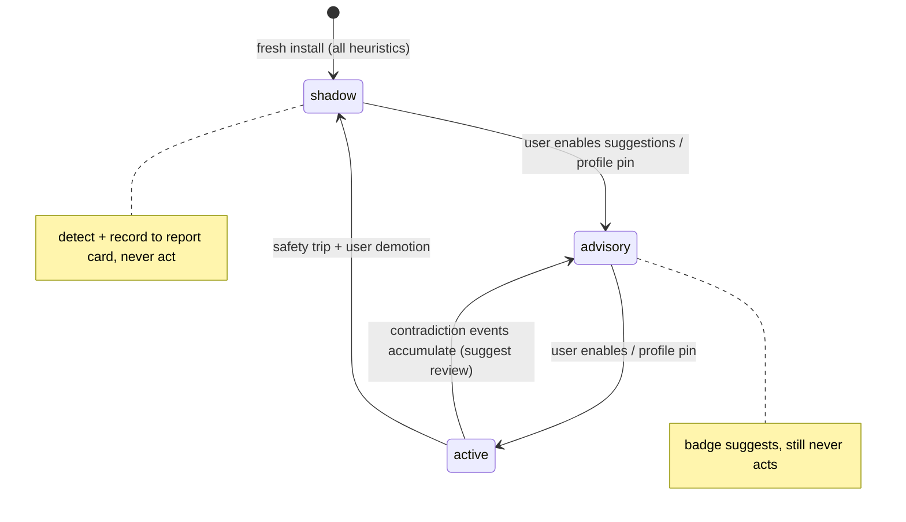

# Design: Enhancement Runtime (`rf-enhance`)

The enhancement runtime is a frame-synchronous observer of the cores plus an
asynchronous farm of decode/analysis jobs. It never mutates core state. Its
output is a **scene graph** consumed by the renderer's enhanced pipeline.

## 1. Event flow

```
core (run_frame) ──CoreSink──▶ FrameBundle ──▶ EnhancementRuntime::on_frame
                                                 ├─ SpriteHistorian      (generic)
                                                 ├─ ScrollTracker/Stitcher (generic)
                                                 ├─ ProfileDecoders      (game-aware)
                                                 ├─ PluginHost           (user-enabled)
                                                 └─ SceneComposer ──▶ SceneGraph ──▶ rf-renderer
```

Subscriptions are declared up front (`EventMask`) so cores skip emission for
unwatched events. Heavy work (level decode, stitching, AI) is posted to
worker threads; the frame-synchronous path only updates small state and
composes the scene.

## 2. Anti-flicker (generic, with per-game overrides)

Original behavior: NES PPU draws max 8 sprites/scanline (SNES: 32 sprites /
34 tile-slivers); games rotate OAM order so overflow alternates between
objects — perceived as flicker.

Two independent, separately-toggleable mechanisms:

1. **Sprite-limit bypass** (render-layer): the core still *evaluates* OAM
   exactly as hardware (sprite-0 hit and overflow flags stay correct — game
   logic depends on them), but the emitted scanline includes the sprites that
   the limit would have dropped, flagged `dropped_by_limit`. Enhanced render
   draws them; Accuracy render ignores them. This is the Mesen-proven
   approach.
2. **Temporal reconstruction** (for games that *pre-cull* in software —
   rotating which entities get OAM slots at all): `SpriteHistorian` keeps an
   N-frame ring (default 4) of OAM snapshots keyed by (tile, palette,
   approx-position). A sprite present in ≥k of the last N frames but absent
   this frame is a *flicker candidate* re-drawn at its motion-extrapolated
   position with last-known attributes.

Safety: (a) candidates are dropped on scene changes (scroll jump, palette
swap, rendering-disable) — these signal intentional disappearance; (b)
profiles can exclude OAM ranges or disable reconstruction (some games hide
sprites deliberately: invisibility effects, damage blink — blink detection
uses period regularity but is imperfect); (c) debug panel shows
original-vs-reconstructed OAM diff per frame.

## 2a. Heuristic trust ladder (D-004)

Every heuristic in this document — temporal reconstruction, blink
detection, HUD-band detection, scene-cut identity, idle-loop detection,
sprite-limit auto-re-enable — runs the same lifecycle:



- **Shadow**: the heuristic computes its verdicts and records them (plus
  what it *would* have done) to the per-game report card. Zero render
  effect.
- **Advisory**: the ENHANCED badge / Enhance workspace suggests ("de-flicker
  would reconstruct 12 sprites in this scene"), still no effect.
- **Active**: acts; contradiction events (safety re-enable, scene-cut
  reset, blink-period violation) still record.
- **Report card** (FR-ENH-012): per-game, local, persisted by normalized
  hash; shown in the Enhance workspace Features tab. Suppressing a safety
  (e.g. "stop auto-re-enabling the sprite limit here") stores a
  justification and auto-reopens if the trigger fires in a different scene
  context.
- **Red fixtures** (FR-ENH-013): each heuristic has an RF-Scroller scene or
  dedicated ROM that MUST trigger it; CI fails if it stops firing.
- Profile `[capabilities]`/`[antiflicker]` entries may pin ladder states —
  that is precisely what a profile is for.

## 3. Generic map stitching: the per-layer canvas model (wideNES technique, W33)

Verified prior art: wideNES (Prilik) — sample PPU scroll registers each
frame, detect the delta, and blit the *newly revealed* strip of the rendered
background into a persistent large canvas keyed by "scene". RetroForge keeps
that idea and applies it per background layer, per line, for both consoles,
in one module: `rf-enhance::canvas` (`CanvasModel` -> `SceneCanvases` ->
`LayerCanvases`). Numbers: `docs/research/W33-results.md`.

**Layers.** NES is layer 0 (`ScrollTracker` bands become per-row positions).
SNES has one canvas per widened background layer, including layers that
reach the screen only through the colour-math sub-screen (SMW's hills, BG2).
A layer that never moves while another does and covers < 75% of rows is HUD
and is left out of the margins.

**Per-line placement.** The frame bundle carries per-line registers (per-layer
HOFS/VOFS, TM/TS, colour math, fixed colour, brightness) and sub-screen pixels,
captured only while widescreen is on (the accuracy hash is unchanged, tested;
0.008 ms/frame). Each row is written at that line's own scroll, so HDMA
parallax skies land where they were drawn. Scroll registers describe the NEXT
frame, so stitching uses the previous read (`ScrollLag`, one rule for every
path). `place_rows` is the single writer for both consoles; holes never erase.

**Colour, sub-screen and backdrop.** A margin cell is composed like the PPU
would (main layers from TM, sub from TS behind, colour math, brightness; fullsnes).
Cells carry a palette id into a per-scene `PaletteTable` (exact CGRAM key,
256 cap) so a remembered cell resolves with its own palette. Unknown cells
take the row's backdrop rebuilt from CGRAM[0], fixed colour, colour math and
brightness, not black.

**Confidence.** Every frame each placed band is compared (subsampled, palette
index) with the canvas at its predicted position. A disagreeing band is not
written; a +-8 px search reports where the picture really sits. Confidence is
0-3 per layer per scene (down 1 per 3 bad frames, up 1 per 30 clean): below 2
a layer is left out of the margins, 0 falls back to VRAM margins. A stable
picture that disagrees wholly (a missed scene change) is learned as a
candidate canvas and promoted after 45 agreeing frames; a candidate learned
from a fade restarts from the settled frame. The Enhancements panel shows the
readout.

**Scenes.** Identity = the profile's `[[scene.level_id]]` bytes when it
declares them, else the settled picture's palette set; cuts on key or bank
change, colour-histogram jumps, unexplained 64+ px scroll jumps and axis
switches; a new scene is named after 12 settled frames. Transitions are
`SceneEdge`s; only a *continuous* edge may show a neighbouring scene in a
margin (`docs/research/W33-09-scenes.md`).

**Persistence v2.** One `rf-cache` entry per (ROM sha256, scene id) under
`canvas-chunk-v2`: the layer canvases, palette table, confidence, edges and a
scouted flag, framed (magic, version, CRC32) with a zstd body, written
atomically on scene cut, a 5 s flush, scout done and drop; bounded reads. Old
or corrupt entries read as a miss. A scene restored as scouted skips the
scout, so the second visit is instant (SMW YI1 margins full at live frame 17,
66.7 KB on disk).

**The level scout** (`crates/retroforge/src/scout.rs`, profile `[scout]`). A
second machine restored from a snapshot of the live one, on its own thread,
drives the game ahead of the camera so the game itself streams and draws the
level; dirty-box deltas are merged on the core thread (<= 2 per frame) into
UNKNOWN cells only. Cells are tagged `Live | Scout`: a live write turns a scout
cell live, registration ignores scout evidence, and only layers at confidence
3 take scout cells. Each delta is checked against a copy of the live canvas
(>= 99% merge, 95-99% merge and slow down, < 95% reject), after first probing
the step against half the step. A ladder `player_move` -> `walk` ->
`camera_write` -> give up is tried per scene, the winning rung is stored with
the scene; the scout follows the scene's axis (X, Y, or both) and is started
only while a live gate says the player is in a level. Settings come from a
hand table or from "Find scout settings for this game" (`scout_finder`:
observation, then trials on a second machine; saved to the player's own
profile only).

**Honest limits.** Scenery is complete where the scout reaches; sprites are
only ever the game's own live ones (the scout never contributes enemies or
moving objects); doors, pipes, scroll locks and forward-only engines end a
pass, so those areas stay "visited only". Settings are found by observation
per game and can be wrong; a refused scout leaves the margins as the live
canvas knows them.

## 4. Game-aware full-level reconstruction (profile-driven)

For supported games, `ProfileDecoders` build the level *from data*, not
observation:

Pipeline for a side-scroller profile:
1. `rom_map` rules locate level pointer table → per-level chunk/screen lists.
2. `decode.metatiles` describes metatile → tile → CHR mapping + palette
   attribute derivation.
3. Decoder emits a `DecodedLevel { chunks[], collision[], objects[] }` into
   the scene graph + cache (all offline-safe: pure function of ROM bytes).
4. At runtime, `memory_map` rules give camera/player/entity addresses; the
   composer places live sprites over the decoded level and drives the
   enhanced camera (ultrawide crop, zoom-out, or full-map).
5. Original viewport can be outlined inside the enhanced view (compare mode).

Top-down variant: room decoder + adjacency graph (from ROM door/exit tables)
→ stitched multi-room canvas; screen-transition events animate a smooth
camera pan over the stitched map while the core does its normal room swap —
transitions *appear* continuous without touching game logic.

Off-screen enemies: drawn only if the profile marks entity data as valid
while off-screen (many games don't simulate off-screen entities — drawing
their spawn points instead is the honest option, sourced from ROM object
tables).

## 5. Loading/transition strategies (opt-in, per strategy)

1. **Fast-forward**: profile marks known wait loops (PC address + condition);
   emulator runs uncapped (no frame pacing) during them. Safe: simulation
   unchanged, just not real-time. Generic idle-loop *detection* ships only as
   a debug analysis tool, not auto-applied.
2. **Predecode**: decoded assets/canvases cached ahead of need (pure reads).
3. **Seamless transitions**: render-side masking of room swaps using the
   stitched/decoded map (§3/§4) — core still executes the transition.
4. **Native-enhanced / patching**: actual game-logic changes (removing a door
   fade, expanding camera in-game) are **mods**: explicit user-enabled
   patches shipped in profiles, off by default, flagged in UI and in save
   states (state chunk records active patches).

## 6. AI integration (future, `rf-ai`)

Contract: `Enhancer` jobs consume cache keys (tile/sprite/layer images with
palette + metadata) and produce cache entries; the composer prefers an
enhanced asset when `(rom, asset, model, settings)` hits the cache, else
falls back to original — **zero AI on the frame path**.

- Asset extraction is exact (indexed pixels + palette from the core), so
  matching is hash-based like Mesen HD packs, not fuzzy image matching.
- v1 targets: offline sprite-sheet/background upscale (local ONNX ESRGAN-class
  model), user-reviewable pack output (same format as hand-made replacement
  packs — one pipeline for AI packs and artist packs).
- Later: widescreen outpainting (profile-gated, clearly labeled
  approximate), HUD/text detection for translation & accessibility overlays.
- Sprite → animation-set grouping: cluster extracted sprites by OAM tile id
  + adjacency-in-time (frames where one replaces another at the same entity
  position) into animation sets, so a pack upscales a character coherently
  instead of per-frame; sets are user-reviewable in the pack editor.
- Object-aware enhancement: when a profile defines entity kinds
  (`[entities]` table), packs may key variants per entity kind (e.g. distinct
  treatment for player vs projectiles) — profile-gated, falls back to
  tile-hash matching.
- AI-assisted reverse engineering (P9+, assist-only): suggest labels for RAM
  addresses from access-pattern traces and candidate level-data regions from
  ROM entropy/structure scans, surfaced as *suggestions* in the debugger's
  annotation store — a human accepts/rejects; profiles never ship
  unreviewed AI output.
- Never required; never cloud by default.

## 7. Scene graph (renderer contract)

```rust
pub struct SceneGraph {
    pub camera: Camera,                  // original | ultrawide | full-map
    pub layers: Vec<SceneLayer>,         // back-to-front
}
pub enum SceneLayer {
    OriginalFrame { texture: TexId },                    // passthrough / compare
    StitchedCanvas { canvas: CanvasId, fog: FogStyle },
    DecodedLevel { level: LevelId, dirty: Vec<ChunkId> },
    ExtractedBg { layer: BgLayerId },                    // per-BG from core metadata
    SpriteSet { sprites: Vec<SpriteInstance> },          // de-flickered union
    HudPinned { region: HudRegion, anchor: Anchor },
    OverlayCmds { cmds: Vec<DrawCmd> },                  // plugins/debugger
    // Ticket W16-06: "walls pop up" -- a per-tile solidity mask and depth
    // field over a decoded level's tiles, row-major, plus the world-pixel
    // origin of tile (0,0). Producer: rf_enhance::scene_graph::
    // geometry_layer / crate::level_view::diorama_geometry_layer.
    Geometry {
        level: LevelId,
        tiles_w: u32,
        tiles_h: u32,
        tile_px: u32,
        solid: Vec<u8>,
        depth: Vec<u8>,
        origin_px: (i32, i32),
    },
}
```

Composer rules keep original priority order within game layers; overlays are
always topmost; HUD pinning only active when a profile (or verified
heuristic) defines the HUD region.

**`Geometry` (ticket W16-06, shipped).** Producer:
`rf_enhance::scene_graph::geometry_layer` (a per-screen solidity mask via
`solidity_mask` plus a fixed extrusion height, `WALL_HEIGHT_EIGHTHS`, on
every solid tile) and the profile-aware wrapper `crate::level_view::
diorama_geometry_layer`, which transposes a `metatile_screens`
`DecodedLevel`'s column-major tiles into this layer's row-major shape and
returns `None` when the profile declared no collision table. Resolved by
the app shell (`crates/retroforge/src/enhanced_view.rs::compose_diorama`,
`ARCHITECTURE.md` §3's shell-mediated split — `rf-renderer` has no
dependency on `rf-enhance`) into `rf_renderer::diorama_mesh::
DioramaScene`/`build_vertices` and rendered by `rf_renderer::diorama::
DioramaPass` (`docs/design/RENDERER.md` §3a). Gated NON_GOALS #11-style:
only a decode's own tiles are extruded, never a guessed "whole level".

**Later**: the first producers for `ExtractedBg` and `DecodedLevel` are
Wave 16 work — see `docs/design/ENHANCEMENT_WAVE_16.md` §3/§9.

## 8. Heights and light (W34)

How the Diorama learns what is solid, stands the picture up, and lights it.
Design and rationale: `docs/design/HD2D_PLAN.md`; the "as built" sections there
hold the per-ticket numbers. Everything here is a presentation overlay: the
core only gains read-only capture switches (`SetTileGridCapture`,
`SetOrientationHint`, like `SetSnesDebugCapture`), and the Accuracy frame is
byte-identical with heights, shadows and lens on or off
(`diorama_camera_live.rs`). Accuracy Mode cannot turn any of it on (law 6).

**Tile grids (W34-01).** While Diorama is on outside Accuracy Mode the core
thread builds a `TileGrid` per background layer for NES and SNES: one cell per
8x8 block with a key (FNV of the pattern bytes plus the palette), flip and
priority bits, a blank flag and a HUD flag, per-line scroll honoured. At most
61 KB per frame, gated, shipped on the frame message.

**Player and orientation (W34-02).** `PlayerTracker` clusters OAM into
entities and names the player by correlating motion with the pad; a gravity
test (falls when unsupported, rises only after a button) separates
`SideView` from `TopDown`; anything else is `Unknown` and renders flat, and
the readout says so. A profile's `[camera].mode` is a hint taken first
(`SetOrientationHint`, re-sent to each new core). Player recall on the real-game
harness is >= 80 % of frames (W34-02b).

**The learner and its guard (W34-03, 03b).** `rf_enhance::heights::HeightLearner`
turns grids + player track + orientation into per-key evidence: S1 the player
stands on it (floor), S2 it blocks horizontal motion (wall), S3 it hides the
player (tall), S4 mass of a key that never overlaps the player, S6 slope
(ramp), S7 the scroll ratio of a layer (backdrop). Evidence climbs a 0-3
confidence ladder; below 2 a key draws flat. Votes count once per key per
frame; blank cells and fills (a key over 25 % of its grid) never vote; only the
playfield (the widest band among layers scrolling with the camera) is ever
raised; HUD grids are never read. A global guard draws flat, forgets the keys
and logs `GuardTrip` when a table would raise more than 40 % of the playfield.
The learner is a pure function of the observation sequence (replay test).
Oracle: RF-Scroller (NES) against its collision table, precision 1.00 / recall
0.80 (misses are walk-through landmarks); a synthetic side view 1.00 / 1.00,
with mutation checks (disable S1: recall drops; shuffle keys: precision drops).
SMW YI1 peak raised cells fell from 183-267 to 79 (typical 16-63) with the
guard, and the hills and status bar are never raised.

**Persistence.** All through the canvas model's one `Cache`: the ROM's
`TileHeightTable` (`tile-heights-v1`, deterministic bytes, zstd, crc32; corrupt
is a miss; 8.5 KB for 1.6 k keys), a heights block per scene
(`heights-canvas-v1`, 16.5 KB; the scene chunk is 68 KB) and the camera call
(113 bytes, kept only when watched from play at confidence 2 or more, drawn
from at once but never fed to the learner, dropped when the game's evidence is
sure). Written when stats changed and 300 frames passed, on leaving a scene and
on Shutdown. A painted `[heights]` table replaces the learned one whole.

**Whole-level heights (W34-07).** `retroforge::level_heights` re-keys a stitched
canvas cell back into the learner's key (colour numbers back into bit planes,
hashed by the same function), after a per-scene alignment vote (shift of the
capture's block grid against the canvas, 0.7 ms once per scene). A pass runs
every 45 frames and at once after a scout delta, on unfinished blocks only.
Limits: 16x16 layers, hires and Mode 7 are not handled, and the NES canvas stores a master colour, so
whole-level heights are SNES-only for now; the NES gets the persisted table and the
camera call.

**Builders.** `rf-renderer::diorama_side::build_vertices_side` stands the
picture upright, extrudes solid cells toward the camera, merges equal-depth
cells, draws only exposed faces, wedges for ramps. The top-down builder is the
floor plan with walls from the grid; the floor runs 16 cells past the room's
edge. Camera: `window_placement` solves the distance so the game's window fits
the frame (`Upright` for side view with the tilt scaled by 0.25, `Ground` for
top-down), following the player's feet through a critically damped spring.
Pass: `Depth32Float`, 4x MSAA, display-resolution render into the flat view's
rect, resources kept between frames.

**Layers, HUD, billboards (W34-08, 09).** The core records which layer drew each
dot (`LayerInfo::ids`, 61 KB a frame; a sub-screen dot belongs to that layer,
which is how SMW's hills are found). `diorama_layers::split` pulls the picture
into planes in one stacked texture: the playfield, one plane per slower layer
at `(1 - ratio) * 48 px` behind, the backdrop 24 px behind the furthest. `HudWatch`
(two 240-frame windows) calls a layer or band HUD (a band at an edge whose
scroll never moves); HUD dots come out of the scene and are composited flat over
the finished 3D image after the lens. Touching sprites are one billboard at the
height under their feet; behind-the-background sprites stand just behind the
playfield plane. At 16:9 / 21:9 / 32:9 the layers extend over the canvas margins
(`margin_pixel_layer`), the planes repeat their edge texels past the picture
(`overscan_px`), and the HUD is only the game's own 256 dots, centred.

**Sun and shadow map (W34-06).** `rf-renderer::lighting::Sun` from the lens's time
of day (the day runs 0.23 to 0.82, elevation `70 sin(pi u)` floored at 10
degrees, azimuth +60 to -60; a dim cool moon outside it; rain 0.6 and snow 0.8
dim it). `lit = colour * (ambient + (1 - ambient) * intensity * max(n.l,0)^0.7 *
shadow)`; noon on level ground is exactly the unlit picture. Normals come from
screen-space derivatives (no vertex change). The shadow map is orthographic,
depth only, 1024^2 below a 768 px target and 2048^2 above, fitted each frame
and snapped to texels, with 3x3 PCF and a slope-scaled bias; billboards cast by
their own silhouette (alpha test 0.5); back planes receive and cast nothing.
`ShadowGate` drops the map after a p95 over 8 ms (120-frame window) and keeps
Lambert and contact ellipses. `set_lighting(None)` is the original shader, so
the pinned goldens did not move.

**Lens over 3D (W34-06b).** `App::store_diorama_result` runs `LensPass` over the
finished Diorama frame (no peek, no painter, Original camera): bloom,
tilt-shift (by screen rows, not depth), grade and weather; 2D sprite shadows are
forced off there. `DioramaRender::rgba` carries the HUD, composited after.

**Costs** (M4 Max, release, machine shared). The pass at 1024x896, p50 / p95:
unlit 0.67 / 1.44 ms, sun + shadow map 0.84 / 1.45. The large win was the
readback: `device.poll(Wait)` returned on ~1.5 ms ticks; polling without
sleeping (`gpu::wait_for_map`) took the pass from 3.0-3.9 ms p95 to about 1 ms
and the lens at 1024x896 from 2.47 / 3.67 to 1.83 / 2.54 (the same fix serves
fog, shader chain, scale and Super FX GPU). Whole-app gate (split + mesh + pass
+ readback + HUD) at the 4x window: SMW layers 1.6-1.9 p50, 2.1-2.9 p95; ALttP
1.8-2.2 p50, 2.0-3.1 p95; 16:9 p50 2.1 / p95 3.0, 32:9 p50 2.5 / p95 3.2-3.4
(the split alone 0.7 ms). Ten minutes of SMW at the 4x window: 110.7 fps off,
104.9 on, gate p95 3.62 ms, RSS peak 509 MB. The app's own gate (16.67 ms p95)
drops the Diorama to flat if it ever trips.
