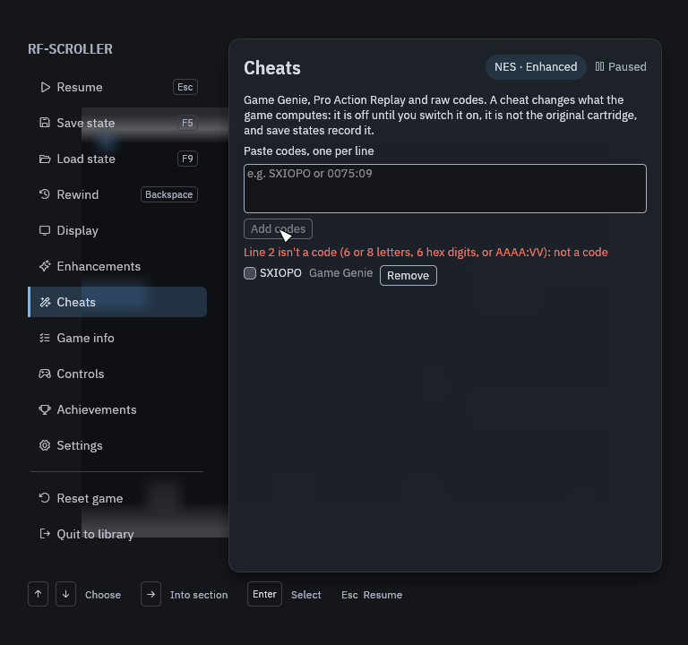
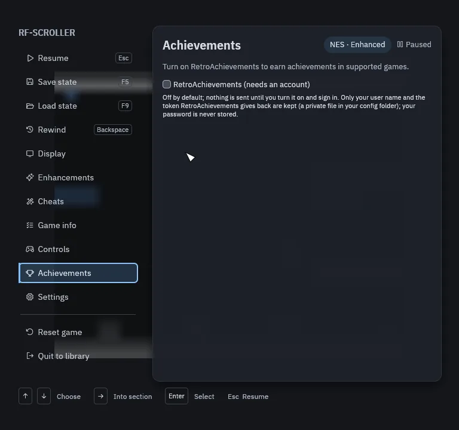
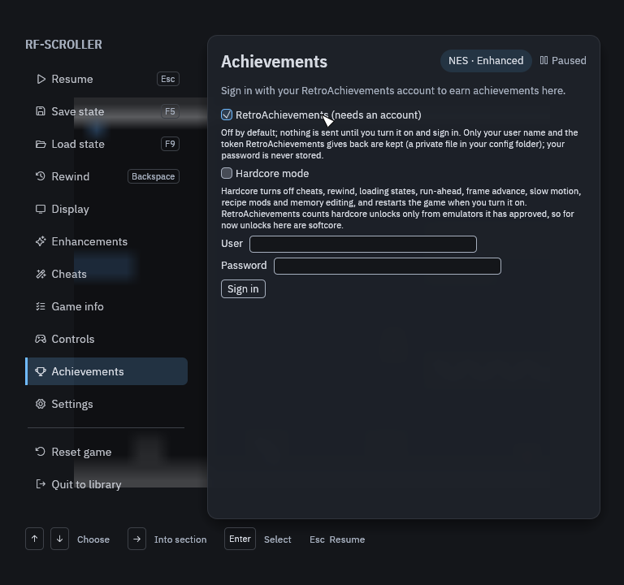
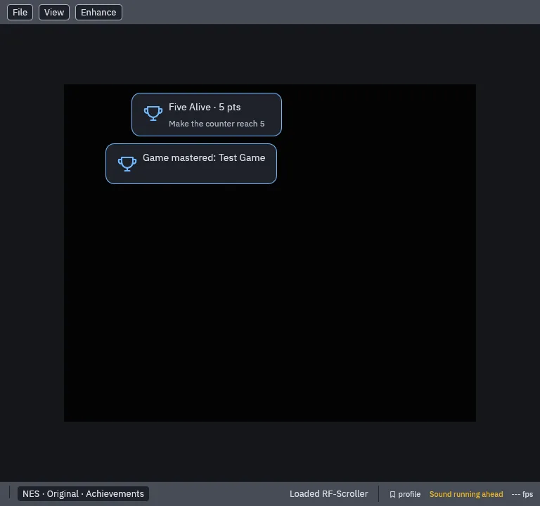
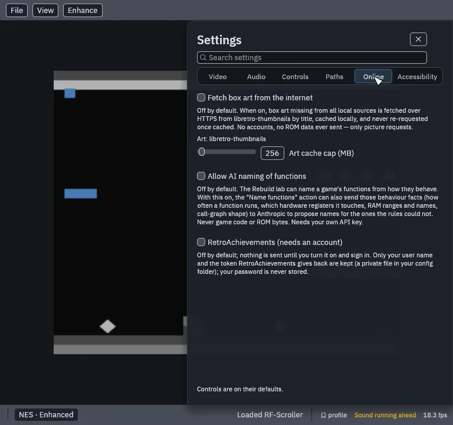

# Cheats and achievements

Cheats and RetroAchievements are both off until you switch them on. Cheats
say plainly that they change the game; achievements send nothing until you
sign in.

## Cheats

Open **Quick Menu › Cheats**, paste your codes (one per line) and press
**Add codes**. RetroForge reads three kinds:

| Kind | NES | SNES |
|---|---|---|
| Game Genie | 6 or 8 letters, such as `SXIOPO` | `XXXX-XXXX` |
| Pro Action Replay | 6 hex digits | 8 hex digits |
| Raw code (address:value) | `AAAA:VV`, such as `0075:09` | `AAAAAA:VV` |

A `+` joins codes that belong together on one line, and lines starting with
`#` are notes. A line that is not a code is named with the reason, and the
good ones are still added. Each code then has its own switch and a
**Remove** button. Codes are saved for each game and are added switched
off: you tick the ones you want.

A cheat changes what the game computes, so while one is on the session is
not the original cartridge: save states record which cheats were on, and a
raw code may only write the console's own work RAM (and an NES cartridge's
RAM). A Game Genie code that is switched on pauses the Rebuild lab for that
game, because it changes the game's code.

## Mods

Below the cheats, **Mods** lists the edits a game's recipe offers, such as
the Super Mario Bros. live-enemies mod described under
[Widescreen](widescreen.md). A mod edits the game's own code in memory
(never your ROM file), shows the **Patched** badge and keeps its own save
states. It takes effect the next time the game is opened.

## RetroAchievements

[RetroAchievements](https://retroachievements.org) needs a free account of
your own.

1. Open **Quick Menu › Achievements** and turn on **RetroAchievements**.
2. Enter your user name and password and press **Sign in**. Your password is
   never stored: only your user name and the token RetroAchievements sends
   back are kept, in a private file in your config folder.
3. Play. A card shows each achievement as it unlocks, with its points, and
   when the set is mastered. The Achievements page lists every achievement
   for the game, locked or unlocked, with its progress.

| | |
|---|---|
|  |  |

If the connection drops, the page says **RetroAchievements offline, unlocks
queued**, and the unlocks are sent once it is back.

**Hardcore mode** turns off cheats, rewind, loading save states, run-ahead,
slow motion, frame advance, mods and patches, and hook scripts that write
memory. Saving a state, fast-forward and pause still work.
RetroAchievements only counts hardcore unlocks from emulators it has
approved, and RetroForge is not on that list yet, so for now every unlock
counts as softcore.

## Settings › Online

Everything in RetroForge that uses the network is in one place,
**Settings › Online**, and each item is off by default and says exactly
what it sends:

| Setting | What it sends |
|---|---|
| **Fetch box art from the internet** | Picture requests by game title to libretro-thumbnails. No account and no ROM data. |
| **Allow AI naming of functions** | Behaviour facts about a game's functions to Anthropic, with your own API key. Never game code or ROM bytes. See [Rebuild mode](rebuild.md). |
| **RetroAchievements** | Your sign-in, and the achievements you unlock. |

