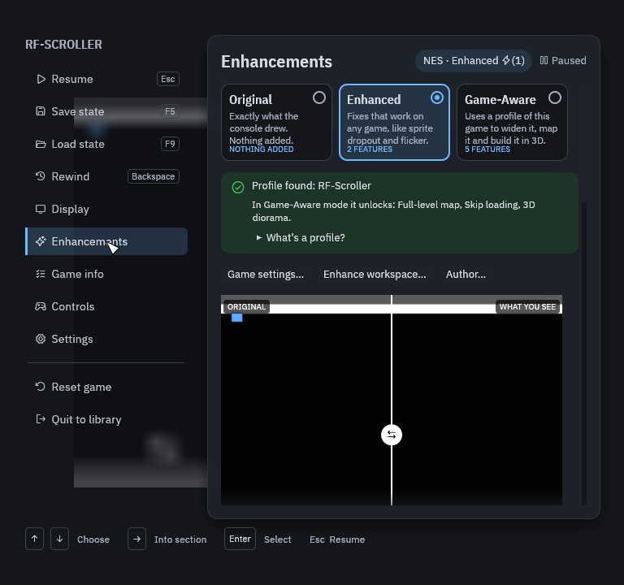
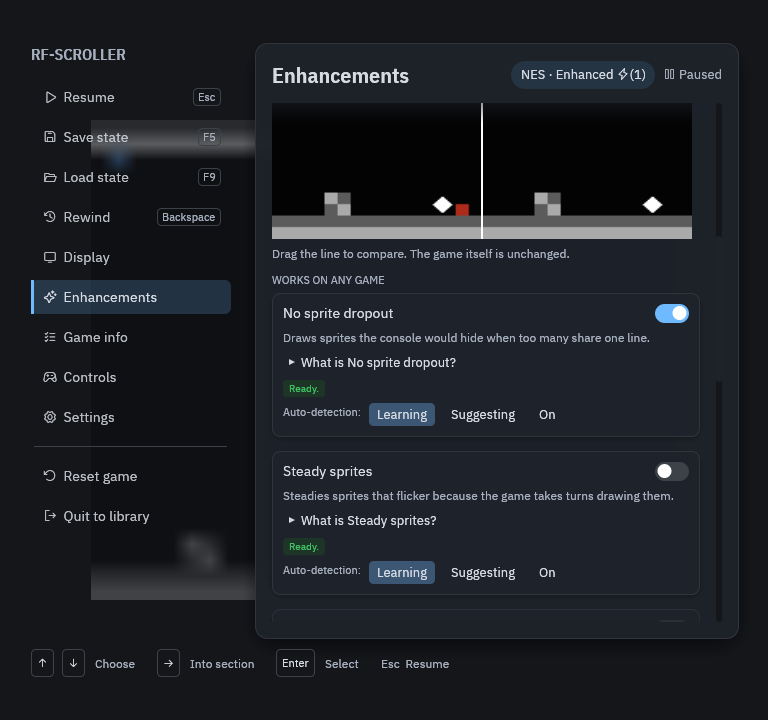
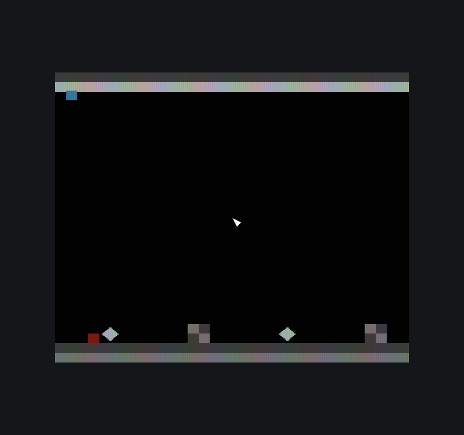
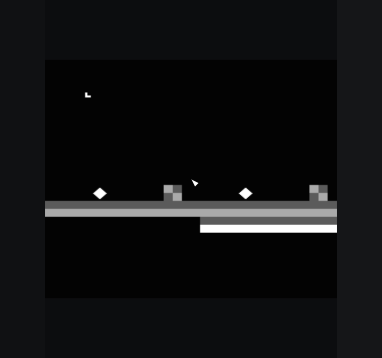
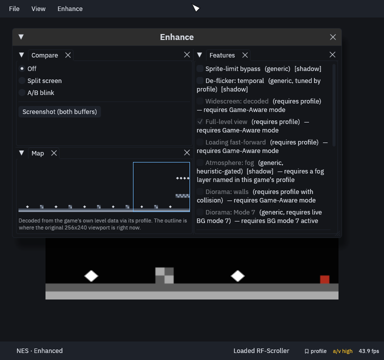

# Modes and enhancements

Every game runs in one of three modes, chosen per game under **Quick Menu ›
Enhancements**. The game itself always runs the same way; modes only change
what is drawn on top of it.

| Mode | What you get |
|---|---|
| **Original** | Exactly what the console drew. Nothing added. The default. |
| **Enhanced** | Fixes that work on any game: no sprite dropout, steady sprites instead of flicker, shaders. |
| **Game-Aware** | Uses this game's profile to widen the picture, map whole levels, skip loading and build them in 3D. |

Each feature says why it is or is not available: it may need a mode, a
profile for this game, or something the game has to be doing (Mode 7 in 3D
needs a Mode 7 scene). The comparison slider underneath shows the original
and what you see side by side.

## Every enhancement

The cards use these names. **Any game** means the card needs no profile, only
the right console or chip; the rest need a profile for this game.

| Card | What it does | Needs |
|---|---|---|
| **No sprite dropout** | Draws sprites the console would hide when too many share one line | Any game |
| **Steady sprites** | Steadies sprites that flicker because the game takes turns drawing them | Any game |
| **Less input lag** | Run-ahead: hides 1 or 2 frames of the game's own input lag by showing a frame from slightly ahead. The game itself runs exactly as before | Any game |
| **Smoother motion** | Invented in-between frames on a 120 Hz or faster screen (see below) | NES or SNES game, Enhanced mode |
| **Smoother sound** | A gentler sound filter than the SNES's own | SNES game |
| **Faster CPU**, **Faster Super FX**, **Faster SA-1 chip** | Removes slowdown by giving the chip more speed only when the game needs it | SNES game with that chip |
| **Less slowdown** | Gives the NES processor extra time between frames | NES game |
| **Sharper Mode 7** | Redraws Mode 7 floors at 2 to 4 times the resolution, with smooth perspective | A Mode 7 scene |
| **Mode 7 in 3D** | Turns a Mode 7 floor into ground you look across | A Mode 7 scene |
| **HD Super FX** | Redraws a Super FX game's 3D shapes on the GPU at 2 to 4 times the resolution, with smoother edges | A Super FX game with a profile that says where its polygons are |
| **Lens and lighting**, **3D diorama** | The [HD-2D look](hd2d.md) | A GPU |
| **Rebuild** | [Rebuild mode](rebuild.md) | NES or SNES game |
| **Widescreen** | [Widescreen and the level scout](widescreen.md) | SNES game, or an NES game RetroForge can scroll |
| **Full-level map** | The whole level as a map, with you on it | Profile |
| **Skip loading** | Speeds through loading waits this game is known to have | Profile |
| **Fog and mist** | Drifting fog where the game draws a fog layer | A game that draws one |

The speed-ups are **Governed** by default: they only remove slowdown and the
game never runs faster than it should. **Fixed** is the advanced choice and
can make a game run faster than intended.

The mode badge in the status bar counts the enhancements that are actually
doing something; one that is switched on but cannot run is not counted.

## Display

**Quick Menu › Display** sizes the picture (the default fits the game
exactly, with no black borders), applies shaders such as CRT, and adds an
ambient glow or a bezel around the picture. Each shader shows a live preview
on your own game, and a choice can apply to this game, every game for this
console, or everything.

**Shader presets.** Tune a shader's settings, type a name and press **Save
as preset** to keep that look; presets appear in the list beside the
built-in ones, and **Delete this preset** removes one. A preset only changes
how the finished picture is drawn, never the game.

| | |
|---|---|
|  |  |

**Smoother motion** (Enhanced mode, NES and SNES games) fills the gaps between the game's frames on a
120 Hz or faster display. The frames in between are made up, from the game's own layers (each background
moved by its own real scroll, each sprite by how far it moved), never blended; the status bar stays put, a
shimmering palette (a question block) is drawn in the colours of the frame it comes from, and with
widescreen on the margins move with the picture. Anything that is not smooth motion just repeats the
game's frame: a cut, a fade or flash, a scroll jump, and on the SNES mode 7, hires, mosaic, windows,
interlace and mid-line register changes. It costs one frame (about 17 ms) of extra delay, so it is off
until you turn it on and it does not exist in Original mode. It steps aside while an HD pack, a shader,
the lens, fog, run-ahead or the Diorama view is on.

## What a profile unlocks

With a matched profile, Game-Aware mode can stitch the level as you play
and show the whole map:

