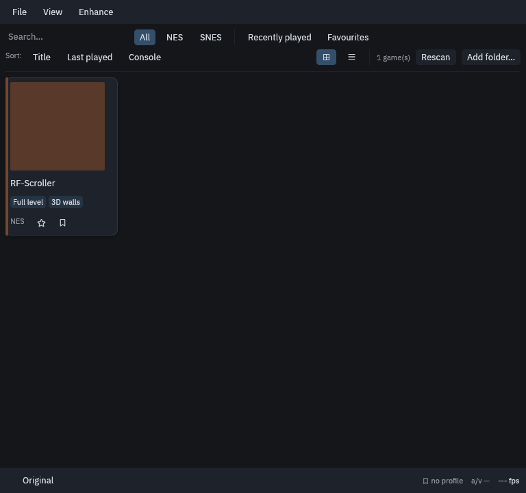
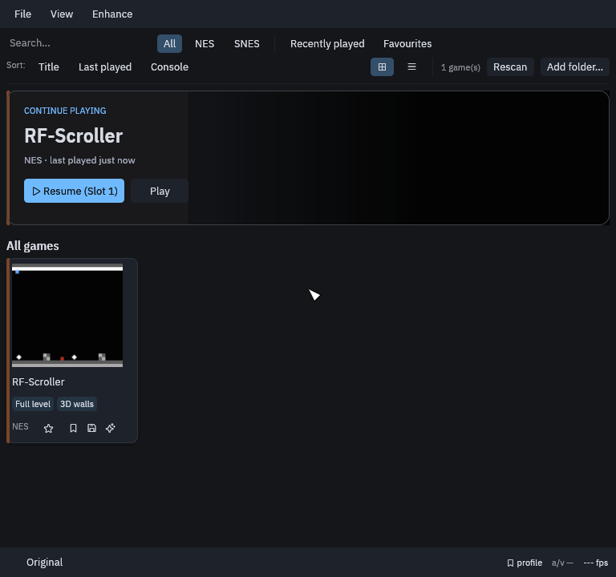
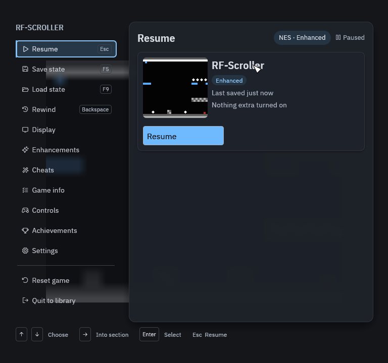
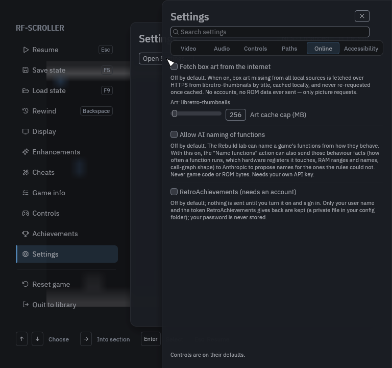

# Getting started

RetroForge plays NES and SNES games you already own. It ships no games and
downloads none: you point it at your own copies.

## Install

Download the archive for your computer from the release page, unpack it,
and run `retroforge` (`retroforge.exe` on Windows). Keep the `profiles`
folder next to it: that is where the app finds its game profiles.

| Computer | Download | Notes |
|---|---|---|
| macOS, Apple silicon | `…-macos-arm64.zip` | Not signed: allow it once under System Settings › Privacy & Security |
| Windows, 64-bit | `…-windows-x86_64.zip` | Not signed: choose "More info", then "Run anyway" |
| Linux, x86-64 | `…-linux-x86_64.tar.gz` | Needs a Vulkan or OpenGL driver, and ALSA for sound |

A fresh install starts in **Original** mode, which shows exactly what the
console drew, with nothing added.

**Graphics.** RetroForge draws with Vulkan on Linux, DirectX 12 or Vulkan on
Windows and Metal on macOS, picking the best one by itself. To choose,
open **Settings › Video › Graphics**; it also says which one is running
and on which GPU. The change applies the next time RetroForge starts, and
if the chosen one cannot start, RetroForge starts on Auto instead.

## Add your games

1. Click **Add folder…** in the library and pick the folder that holds your
   games. Add as many folders as you like.
2. RetroForge reads `.nes`, `.sfc`, `.smc` and `.fig` files, and `.zip` archives
   that contain one.
3. Click a game to play it. **Rescan** picks up games you add later.

Next time, the library opens on **Continue playing**: **Resume** loads the
last game's newest save state, or **Play** starts it fresh.

**Patches.** A `.bps`, `.ips` or `.ups` patch with the same name as the game
(`Game.sfc` and `Game.bps`) is found automatically and applied in memory when
you switch it on; your ROM and the patch file are never changed. See
[Widescreen patches](widescreen.md#widescreen-patches-soft-patching).

The library's chips filter by console, **Recently played** and
**Favourites** (the star on each card). Chips such as **Full level** and
**Widescreen** on a card mean RetroForge has a profile for that exact copy
of the game; see [Game profiles](game-profiles.md).

## While you play

Press **Esc** to open the Quick Menu. It pauses the game; press **Esc**
again to go back to it. Esc only ever closes the top layer: with Settings
open over the menu, Esc closes Settings and leaves you in the menu.

| Section | What it's for |
|---|---|
| Resume | Back to the game (Esc) |
| Save state / Load state | Ten slots per game, with pictures (F5 / F9) |
| Rewind | Go back in time (hold **Backspace** while playing) |
| Display | Size, shaders and shader presets, fullscreen, glow or bezel |
| Enhancements | The mode, and every enhancement this game can use |
| Cheats | Game Genie, Pro Action Replay and raw codes; see [Cheats and achievements](cheats.md) |
| Game info | Lives, health, coins and more, pinned over the game |
| Controls | Keyboard and controller buttons, and the shortcuts |
| Achievements | RetroAchievements sign-in and this game's list |
| Settings | Everything else, with search |
| Reset game / Quit to library | |

**Rewind** keeps a history of the last few seconds. It costs memory, so it is
off until you tick **Rewind** under **Settings › Video**, which shows the cost.

## Settings

**Settings** has six tabs: Video, Audio, Controls, Paths, Online and
Accessibility, and a search box that finds a setting on whichever tab it is.
Anything that uses the network is under **Online**, off by default.

Your settings live in your config folder:

| Computer | Folder |
|---|---|
| macOS | `~/Library/Application Support/retroforge` |
| Windows | `%APPDATA%\retroforge` |
| Linux | `~/.config/retroforge` (or `$XDG_CONFIG_HOME/retroforge`) |

Set `RETROFORGE_CONFIG_DIR` to keep them somewhere else, for example next to
the app for a portable copy.
