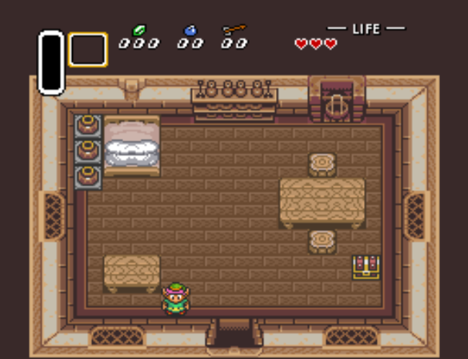
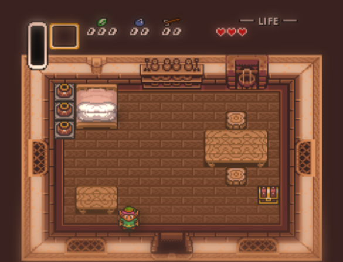
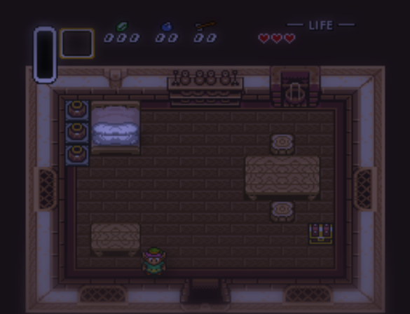
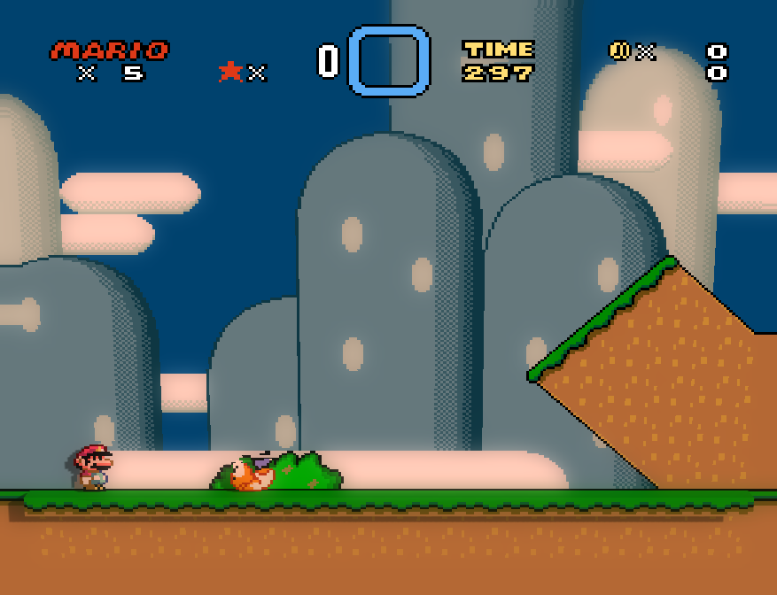
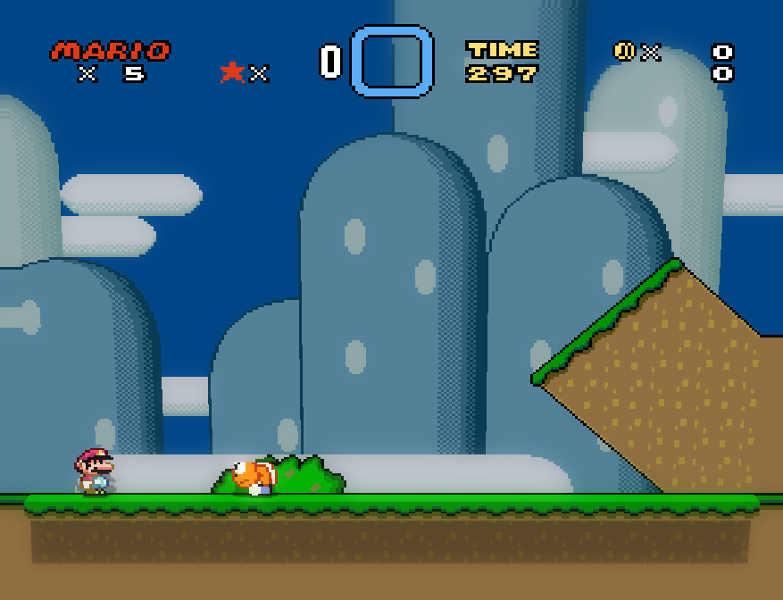
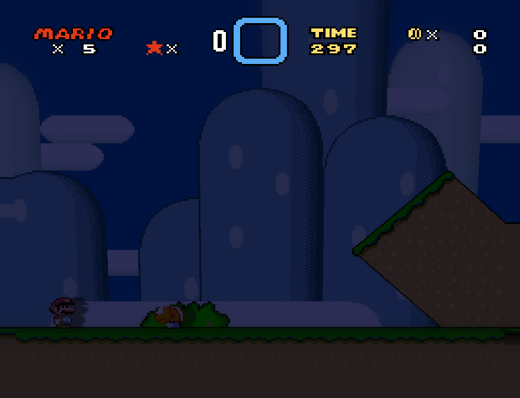
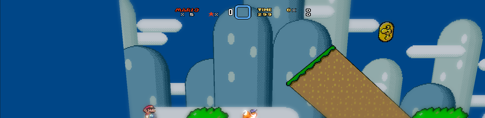

# HD-2D and Diorama

Diorama stands a game's picture up as a small 3D scene: the ground and the
blocks you walk on rise out of the screen, characters stand in front of them
as cut-outs, and the camera can tilt, turn and follow the player. The
**HD-2D look** adds a sun that moves through the day, soft shadows, glow and a
miniature-model focus on top. Your controls and the game stay exactly 2D, and
Accuracy Mode never turns any of it on.

| Flat | HD-2D, morning | HD-2D, dusk |
|---|---|---|
|  |  |  |

## Turning it on

Switch to **Enhanced** mode, open **Quick Menu › Enhancements** and press
**Turn on** on the **HD-2D look** card. One click sets Diorama, the tilted
follow camera, glow, miniature focus, shadows and the colour grade, and
**Turn off** puts your own settings back. Each piece also has its own switch
and strength under **Diorama: walls** and **HD-2D lens and lighting** if you
want less of it.

## "Approximate, learned from play"

The Diorama row reads *approximate, learned from play*. RetroForge has no map
of what is solid in a game it was not given one for, so it works that out by
watching you:

- **Play.** It finds your character, then notices which tiles you stand on,
  which stop you walking and which hide you. Tiles it is sure about rise;
  tiles it is not sure about stay flat. It does not guess, so a new game is a
  flat picture that fills in as you play.
- **The scout's whole-level map.** With widescreen and the level scout on, a
  tile you have learned is recognised everywhere the scout has drawn it, so
  the right-hand margin of a level shows blocks you have not walked to yet.
  The learned tiles are saved per game, and each level's heights are saved too,
  so the second visit has them from the first frame without playing.
- **Painted heights.** A game profile with a `[heights]` table (made in the
  Profile Builder) replaces everything learned. Those heights are exact, and
  the *approximate* label goes away.

Games are told apart as side-on (a platformer: the picture stands upright and
blocks come toward you) or top-down (a floor you look across, like A Link to
the Past). If it cannot tell yet, the picture stays flat and the readout says
so.

## Light and time of day

The sun follows the **Time of day** slider (or **Follow my clock**). It rises
on one side, is high and short-shadowed at noon, and sets low and long on the
other side; at night a dim cool moon takes over. Blocks and characters cast
shadows on what is behind and under them. Rain and snow dim the light a little.

| Morning | Noon | Dusk |
|---|---|---|
|  |  |  |

## Lens effects

Glow, miniature focus, soft shadows, the day-to-night grade and weather are
the same **lens** you can use on the flat picture. Over the Diorama they run
on the finished 3D image. The game's status bar and score are drawn flat on
top afterwards, so they are sharp and never tilt, tint or blur.

## Widescreen Diorama

With widescreen on (16:9, 21:9 or 32:9) the Diorama fills the whole window.
Hills and clouds sit on their own planes behind the ground and slide against it
when the camera turns, and in side-on games the blocks continue into the
margins the level scout filled.

## What it cannot do yet

- **It learns as you play.** Only places you have visited (or the scout has
  drawn, in a side-on SNES level) have heights; everything else is flat.
- **NES games** keep what they learned, but the scout's whole-level heights are
  not available for the NES yet.
- **Top-down games** have flat floors in the widescreen margins; walls come
  only from the screen the game itself draws.
- **The status bar is found by a rule of thumb** (a layer that sits in a band
  at the edge and never scrolls). A wrong call leaves a band flat and the game
  is never affected.
- 16x16 tiles, high-resolution modes and Mode 7 floors are not handled by the
  height learner.
- It needs a graphics card. If the picture ever costs too much time the
  Diorama switches itself off and the flat picture carries on.
