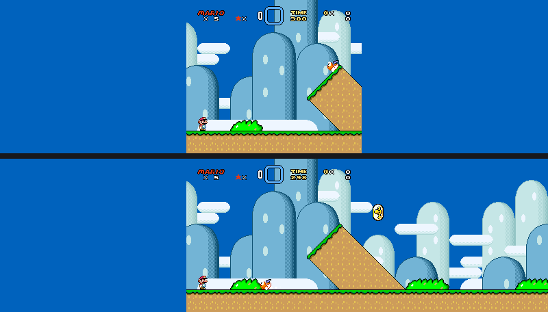
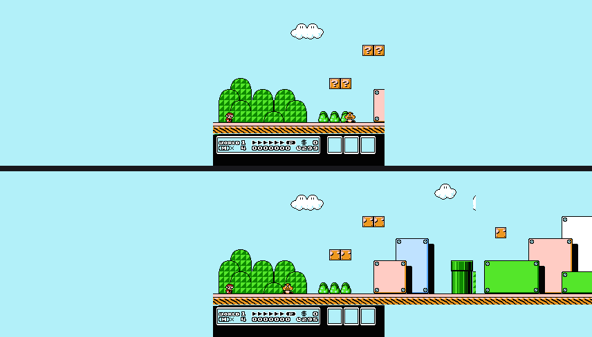
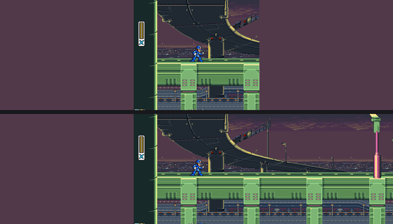
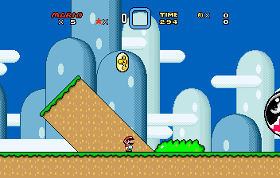

# Widescreen and the level scout

Widescreen draws more of the level than the console showed, so a 4:3 game
fills a 16:9 or 32:9 window instead of sitting in a box. It is an
enhancement, not a change to the game: turn it on under **Quick Menu ›
Enhancements** (Enhanced or Game-Aware mode). Original mode never widens.

Pick the shape you want (16:9 or 32:9). Widescreen is available for SNES
games and for NES games RetroForge knows how to scroll.

## Where the extra picture comes from

RetroForge remembers every part of a level the game has drawn, one canvas per
background layer, and fills the side margins from that memory. On its own
that only shows places you have already been. The **level scout** goes
further: it runs a second, hidden copy of the game a little ahead of you and
steers it through the level so the game itself draws what is coming. Only
scenery is taken from it.

| Off (4:3 only) over on (32:9 with the scout) |
|---|
|  |
|  |
|  |

The scout starts by itself once you are in a level, runs in the background
and does not slow the game down noticeably. The second time you enter a level
it is instant: the remembered level is saved per game and per level and loaded
from disk, so no scout is needed.

## Find scout settings for this game

The scout needs a few facts about a game: where the camera is, where the
player is, and what keeps the hidden copy safe. Games that ship with these
facts just work. For any other game, open **Enhancements** and press
**Find scout settings for this game**, then play a level for about a minute:
walk right and left, jump a few times, then stand still for a second.
RetroForge watches the game's memory, tries what it found on a second copy of
the game, and offers to save the result. It is saved to your own profile for
that game; nothing is changed in the profiles that come with RetroForge.

## Widescreen patches (soft-patching)

Some games have community widescreen patches that make the game itself draw
more (for example the wide-snes patch for Super Mario World). RetroForge
applies standard patch files (.bps, .ips, .ups) in memory when you turn them
on, never touching your ROM or the patch. Put the patch beside the ROM with the
same name (`Game.sfc` and `Game.bps`), or in the game's `patches` folder in the
app's config directory, then switch it on in the game's settings. A `.bso`
beside the ROM (the bsnes-hd convention) tells RetroForge the width the patch
draws; widescreen then turns on at that width automatically and is labelled
"(patch)". The session shows a "Patched" badge, has its own save states, and
is not Accuracy Mode.

## What it cannot do

* Scenery is complete where the scout reaches. Enemies and other moving
  things are only ever the game's own live ones: you see an enemy when the
  game draws it, not before. The one exception is the Super Mario Bros.
  "live enemies" mod below, which keeps enemies alive in the margins and
  draws them there (the session shows the Patched badge).
* The scout cannot reach everything: places behind doors or pipes, rooms the
  game only loads when you get there, sections where the screen stops
  scrolling, and games that cannot scroll backwards. Those margins show what
  you have already visited, or the level's background colour.
* A tall (vertical) section widens sideways only, so on 32:9 it can look
  unchanged.
* Settings for a game are found by watching it, so they can be wrong. A scout
  whose results do not match the real game is refused and the margins fall
  back to what you have seen; the Enhancements panel shows how sure it is.
* NES widescreen shows scenery only; there is no widescreen picture to
  draw beyond what the game scrolled.
* The Super Mario Bros. "live enemies" mod (a per-game mod, off by default,
  under **Mods** in the game's settings) keeps enemies alive up to about 240
  pixels past the screen edges and draws them in the margins from the game's
  own sprite data. It changes what the game computes, so the game is no
  longer the original cartridge: the session shows the Patched badge and has
  its own save states, which record the mod. Where the margin enemies come
  from: the NES draws sprites with a one-byte X, so the game itself hides an
  enemy that far out. RetroForge asks the game to draw it anyway on a private
  copy of the machine, with the camera moved a screen over, and paints what
  that copy drew in the margin. The real picture and the real machine are not
  touched. Limits: the outer 45 pixels or so of each margin stay empty (a
  byte cannot hold more); drawing ignores a sprite's behind-the-background
  priority, so an enemy there always shows in front; only enemies are drawn
  (not platforms or items); and an enemy crossing the screen's own edge can
  be a tile off at the seam. There are only five enemy slots: enemies hold
  theirs longer, which we measured did not cost spawns in 1-1, 1-2 or 4-1 but
  could in a crowded level. Groups of walkers still appear at the old screen
  edge. Drawing margin enemies costs about 3 ms a frame on an M2 Max on average
  (12 ms at worst). Run-ahead works with the mod on, but both it and the margin enemies
  switch off if a hook script is loaded that can write memory (the badge
  says so). Needs the game's code atlas: record some play in the Coverage tab
  and turn Rebuild on once.
